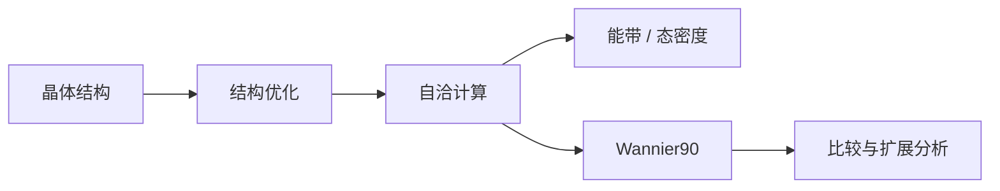

<p align="center"></p>
<h1 align="center">First Principles Pilot</h1>
<p align="center"><strong>A visual workbench for first-principles calculations.</strong><br />把结构、计算流程、远端任务与结果分析放在同一个工作台。</p>
<p align="center">
  <a href="https://github.com/Kakakit/first-principles-pilot/releases"></a>
  <a href="LICENSE"></a>
  <a href="https://github.com/Kakakit/first-principles-pilot/releases/tag/v1.1.0-beta.4"></a>
</p>
<p align="center"><a href="#安装">安装</a> · <a href="#快速上手">快速上手</a> · <a href="#文档">文档</a> · <a href="https://github.com/Kakakit/first-principles-pilot/tree/extensions">扩展</a> · <a href="CONTRIBUTING.md">参与贡献</a></p>

First Principles Pilot（FPilot）面向使用 **VASP、Wannier90 和 HPC 集群**开展材料研究的用户。你可以在本机浏览器中搭建计算流程、编辑输入、选择服务器和任务脚本，跟踪运行记录，并围绕同一份计算来源查看结果和执行后处理。

项目目前处于 **Beta** 阶段，主要界面为中文。计算程序、赝势与服务器环境由使用者自行提供；工作台负责组织和追踪计算，数值收敛与物理结论仍需按研究问题验证。

## 功能

| 工作环节 | 能做什么 |
| --- | --- |
| **结构与流程** | 导入和编辑晶体结构，查看三维模型，在流程画布中连接计算节点，从已有任务提取独立结构。 |
| **输入配置** | 编辑 VASP 参数与 INCAR 原文、KPOINTS、赝势选择及 Wannier90 投影，预览并冻结实际运行输入。 |
| **远端运行** | 通过系统 OpenSSH 连接服务器，导入 PBS / Slurm 脚本，预览资源与运行目录，提交并记录准确的任务回执。 |
| **计算链与扫描** | 组织阶段依赖、参数列表和范围扫描，查看逐个 case 的进度、暂停原因与运行证据。 |
| **结果与分析** | 查看结构、能量、能带、态密度与 Wannier 拟合比较；通过扩展接入更多科学后处理。 |
| **记录与恢复** | 保留输入来源、运行身份和分析关联；自动保存草稿，使用命名检查点、项目快照和回收站恢复工作。 |

一个常见流程可以是：



每次运行有独立的 attempt 记录。任务回执不明时保留 `UNKNOWN` 并核查原回执；新建远端扩展分析优先保存在来源计算项目的 `analyses/` 下，便于计算与分析一一对应。

## 安装

**Apple Silicon Mac 用户：**前往 [Releases](https://github.com/Kakakit/first-principles-pilot/releases/tag/v1.1.0-beta.4) 下载 `FPilot-1.1.0-beta.4-macos-arm64.dmg`，打开后将应用拖入 Applications。安装包内置 Python 和运行依赖，无需另装 Node.js 或 Python。

| 平台 | 安装方式与状态 |
| --- | --- |
| macOS · Apple Silicon（M 系列） | 本次提供 DMG；详细步骤与版本边界见 [安装指南](docs/INSTALLATION.md)。 |
| Windows x64 | 本次不发布新包；历史版本保留在 [Releases](https://github.com/Kakakit/first-principles-pilot/releases)。 |
| Intel Mac / Linux | 本次无安装包；源码运行需自行验证相应平台与计算环境。 |

当前 macOS 测试包使用临时签名，尚未经过 Apple Developer ID 公证。下载后可用随包提供的 SHA256 文件校验；GitHub 自动生成的 Source code 归档是源码，不是安装器。

## 快速上手

1. **启动工作台。**打开应用，在浏览器中确认本机数据目录，新建项目并导入 POSCAR 或 CIF 结构。
2. **搭建流程。**添加计算节点，连接结构与计算来源，检查参数和预期继承的文件。
3. **配置计算环境。**登记自己的 SSH 别名，测试免交互连接，导入服务器上可用的任务脚本，并配置合法的 POTCAR。
4. **预览后运行。**选择服务器、节点和资源，检查冻结输入、脚本与远端目录，再确认本次提交。
5. **查看结果。**在运行记录中分别检查调度状态、程序结束与收敛证据；进入结果页或选择扩展继续分析。

仅浏览结构和编辑草稿无需提交远端任务。关闭浏览器后后台服务可继续运行；停止或更新前，请保存草稿并通过“工作台控制”正常退出。数据目录独立于应用目录，更新应用不会自动迁移旧项目。

## 扩展

后处理扩展独立于主程序开发和分发，入口是同仓库的 **[extensions 分支](https://github.com/Kakakit/first-principles-pilot/tree/extensions)**。下载对应 ZIP 后，在“扩展管理”中导入，选择本地或服务器环境并检查依赖。

扩展可使用独立 Python 环境，分析记录保留实际使用的环境和输入来源。主分支中的旧扩展源码是兼容快照；新版本以扩展分支的说明和清单为准。

## 从源码运行

准备 Node.js 22 和已有的 Python 3.11 解释器。以下 `python` 指你选定的解释器：

```sh
git clone https://github.com/Kakakit/first-principles-pilot.git
cd first-principles-pilot
python -m pip install -r packaging/requirements-runtime.txt
npm ci
npm run build
python launch.py --check
python launch.py
```

前后端开发使用 `npm start`。启动器可通过 `FPILOT_PYTHON` 指定已有解释器；停止、重启与状态检查分别使用 `npm stop`、`npm run restart`、`npm run status`。配置和本机数据不应提交到 Git。

安装包的构建与运行方式见 [源码与打包指南](docs/GITHUB.md)，开发及测试说明见 [CONTRIBUTING.md](CONTRIBUTING.md)。

## 文档

| 主题 | 入口 |
| --- | --- |
| 安装、更新、数据目录与启动诊断 | [安装指南](docs/INSTALLATION.md) |
| 源码运行与打包 | [GitHub 与源码指南](docs/GITHUB.md) |
| SSH、服务器与任务脚本 | [首次配置](docs/submission/SETUP_AND_SCRIPT_ACCEPTANCE.md) |
| 计算提交与运行来源 | [提交流程](docs/submission/ACCEPTANCE.md) |
| Wannier 能窗与拟合比较 | [Wannier 工作流](docs/wannier-window/README.md) |
| 扩展开发与环境设置 | [扩展协议](docs/extensions-b/PROTOCOL.md) · [环境配置](docs/extensions-b/ENVIRONMENTS_ACCEPTANCE.md) |
| 自动保存、检查点与恢复 | [保存与恢复](docs/storage/SAVE_RECOVERY_20261028.md) |

版本变化见 [更新记录](CHANGELOG.md)。

## 参与贡献与反馈

欢迎通过 [Issues](https://github.com/Kakakit/first-principles-pilot/issues) 报告问题、讨论功能，或提交 Pull Request 改进代码和文档。请附上软件版本、操作系统、复现步骤及经过脱敏的最小输入；涉及科学结果时注明单位、输入来源和收敛条件。具体流程见 [贡献指南](CONTRIBUTING.md)。

## 许可证与致谢

FPilot 的原创代码采用 **[MIT License](LICENSE)**。仓库中的第三方代码、资源与运行依赖保留各自许可证；安装包附带第三方声明和可用的许可证文本。VASP、POTCAR 及外部计算程序不包含在本项目的许可授权中。

感谢 [pymatgen](https://github.com/materialsproject/pymatgen)、[spglib](https://github.com/spglib/spglib)、[React](https://github.com/facebook/react)、[React Flow](https://github.com/xyflow/xyflow)、[FastAPI](https://github.com/fastapi/fastapi)、[3Dmol.js](https://github.com/3dmol/3Dmol.js) 和 [Apache ECharts](https://github.com/apache/echarts) 等开源项目。
