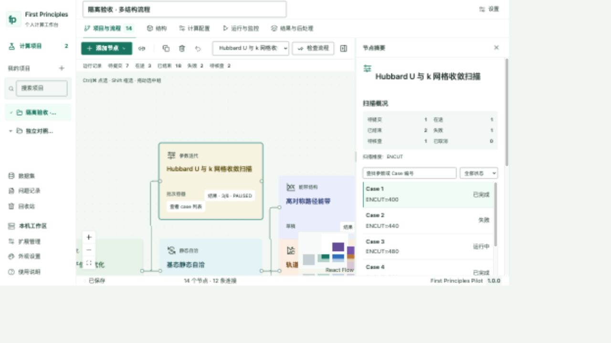
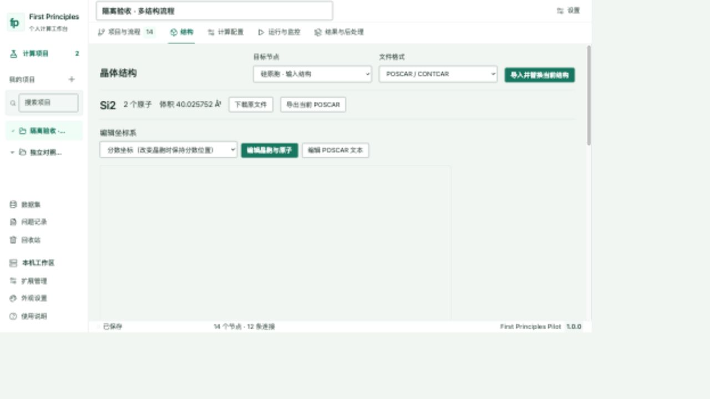
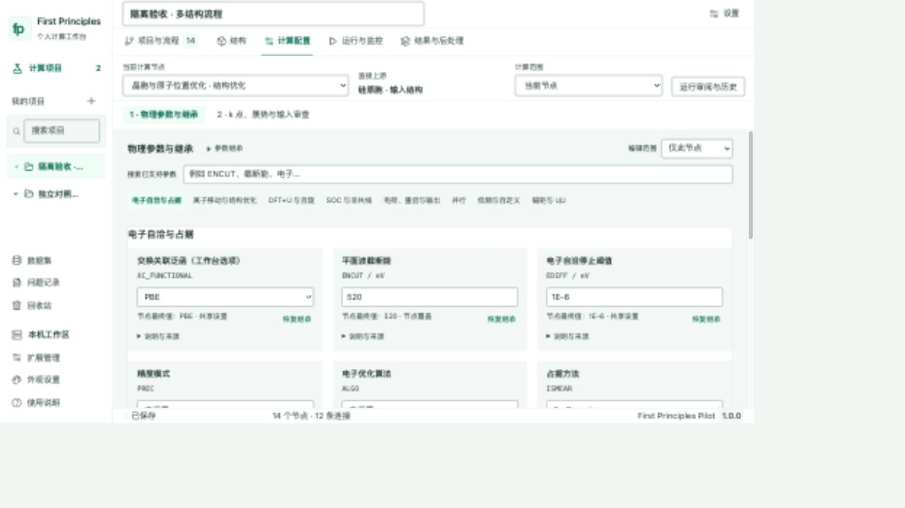
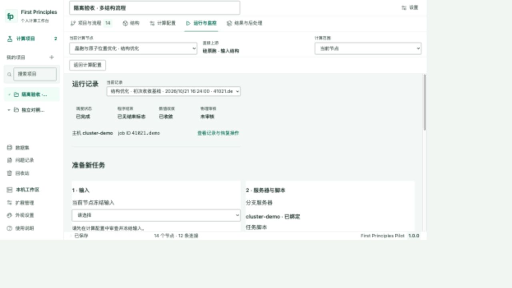
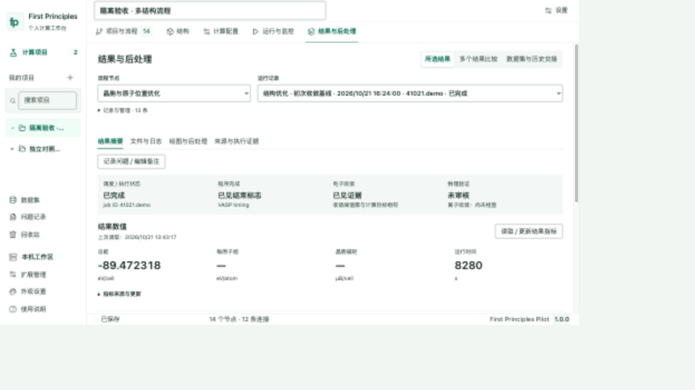
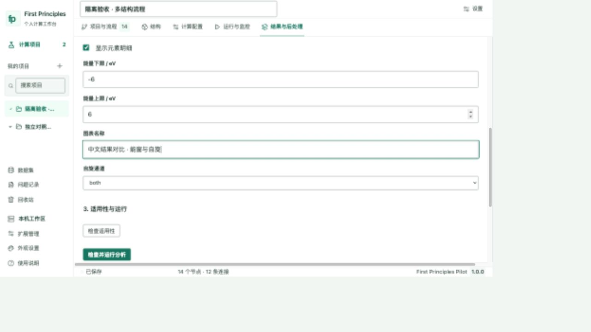
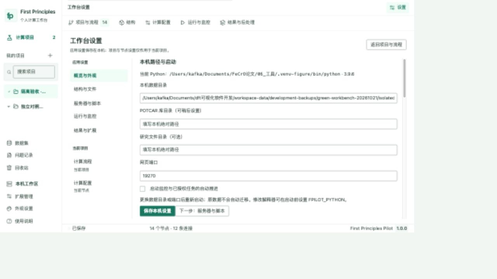

# 绿色工作台 · 分包交付与使用记录

两项功能先以原布局单独提交，然后完成五个视觉包。沿用 React/TypeScript/Vite/React Flow/Lucide，未增加UI框架或工作流框架。

| 内容 | main 提交 | 记录 |
|---|---|---|
| 结构卡片直达与选择同步 | `8d39616` | [功能](00_FUNCTIONS.md) |
| 冻结备注与运行记录命名 | `29fbc76` | [功能](00_FUNCTIONS.md) |
| 视觉规范与基础组件 | `a86128a` | [包1](UI1.md) |
| 融合主页与结构 | `9784aca` | [包2](UI2.md) |
| 配置与运行监控 | `e7b1c7a` | [包3](UI3.md) |
| 结果与后处理 | `5e52883` | [包4](UI4.md) |
| 设置与全局收尾 | 本记录所在提交 | [包5与最终验收](UI5.md) |

## 使用

- 顶部五板块保持固定。进入项目先打开融合画布；左栏选项目，右栏可关闭或拖动调宽，也支持方向键与Home。
- 点结构卡片的“打开结构详情”直接选择对应结构；结构页下拉切换同步画布选择。
- 普通节点右栏切换本机运行记录，查看冻结备注、主机、job ID、四层证据与已有指标。配置表单在专门页面打开。
- 扫描节点“查看case列表”在右栏按状态、参数或编号查找，每页10项；选择case查看证据及完整回执。画布不再堆叠case，不改变已保存的节点位置。
- 结果、历史、比较、后处理来源采用“冻结备注 → 明确关联计算链的作业名称 → 未填写备注”。仍保留时间、job ID/短ID和状态；扫描标题保持参数差异。
- 设置按应用/项目分组，服务器使用横向列表选择。外观仍可导入、导出原JSON格式；旧主题中的自定义字号与配色保留。

## 验收范围

独立交付副本：62项相关后端测试、139项全部前端测试、类型与生产构建通过。结构功能提交另经24项专项验证。UI包只做相关域检查；无调度/执行逻辑修改，不把这轮验证称为真实作业回归。

浏览器使用合成项目、两份Si结构、14个节点、33条运行记录、失败/UNKNOWN/已结束未收敛等状态。扩展表单使用固定内存适配清单；没有运行扩展。三尺寸共18个页面组合、六页面深色/大字、原生Safari125%、键盘焦点和保存位置均见包5。iframe卸载检查通过，未开展长期堆内存测量。

本次本机隔离入口为 `http://127.0.0.1:19270`，仅连接19268合成API；它不是正式工作区。正式服务未重启，正常重启后载入源码。一次性验收服务、脚本和原始回执留在本机归档，不作为产品启动器。

## 截图

| 项目与流程 | 结构 |
|---|---|
|  |  |

| 配置 | 监控 |
|---|---|
|  |  |

| 结果 | 后处理 |
|---|---|
|  |  |

原生125%的菜单及页面原图仅保留本机验收归档，避免在仓库截图中包含个人浏览器工具栏。
